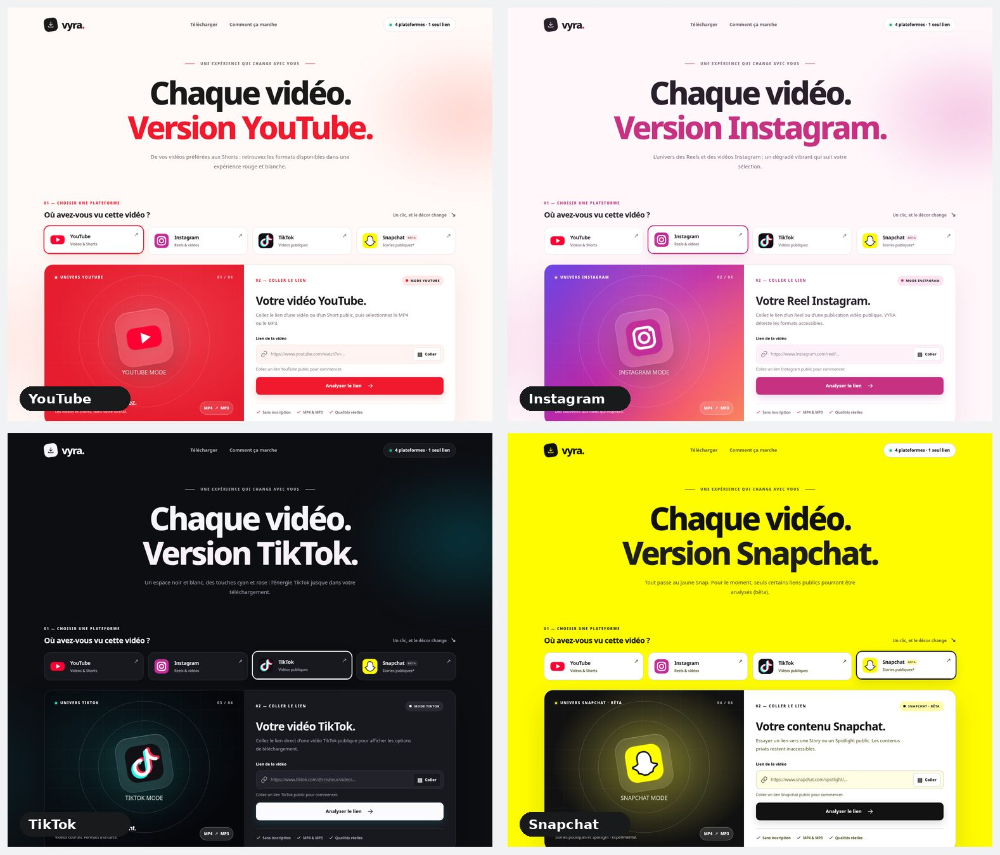

<div align="center">

# 🎬 VYRA

### Chaque vidéo, dans son univers.

**Téléchargeur web multiréseaux auto-hébergé — interface immersive V2**

[](./docs/ROADMAP.md)
[](./docs/VALIDATION.md)
[](./Dockerfile)
[](./LICENSE)
[](./.github/workflows/ci.yml)



**[Explorer la démo locale](./DEMO_INTERFACE.html)** · **[Installation](#-installation-rapide)** · **[Architecture](./docs/ARCHITECTURE.md)** · **[Roadmap](./docs/ROADMAP.md)**

</div>

> [!IMPORTANT]
> **VYRA V2 est un prototype à auto-héberger, pas un service de téléchargement public prêt à la production.** Son interface et son API sont intégrées ; les tests automatisés utilisent une simulation du moteur de téléchargement. L'accès réel aux contenus dépend des plateformes et doit encore être validé sur des vidéos autorisées. Snapchat reste expérimental.

---

## 🎯 Vision et promesse

VYRA rassemble dans **une seule expérience web** les opérations de récupération de médias que l'utilisateur est autorisé à télécharger. Au lieu d'un formulaire générique, chaque plateforme possède son identité : on sait immédiatement quel réseau est sélectionné. Le choix d'une plateforme **ne contourne jamais** le contrôle de l'URL effectué par le serveur.

**Parcours cible :** choisir un réseau ou coller un lien → identifier le contenu → consulter les formats proposés → sélectionner MP4 ou MP3 et la qualité disponible → lancer le traitement → récupérer le fichier.

## 🎨 Une plateforme, quatre univers

| Réseau | Identité visuelle V2 | Types de liens visés | Maturité |
|---|---|---|---|
| **YouTube** | Rouge & blanc, lumineux | Vidéos publiques, Shorts | Implémenté ; essais réels requis |
| **Instagram** | Dégradé rose, violet, orange | Publications, Reels et stories publiques accessibles | Implémenté ; essais réels requis |
| **TikTok** | Noir & blanc, accents cyan et rose | Vidéos publiques | Implémenté ; essais réels requis |
| **Snapchat** | Jaune, noir & blanc | Quelques liens publics | **Bêta, sans garantie d'extraction** |

Les changements de palette sont **animés** : fond, surfaces, boutons, pictogramme central et tonalité des textes évoluent ensemble. La détection automatique se fait dès qu'une URL reconnue est saisie ou collée. La navigation clavier, `aria-pressed`, le responsive mobile et `prefers-reduced-motion` sont pris en compte.

La démo indépendante `DEMO_INTERFACE.html` permet d'essayer les quatre univers **sans Docker** : après clonage ou téléchargement, ouvrir le fichier localement dans un navigateur. **Elle ne télécharge aucune vidéo.**

## ✅ Fonctionnalités et état réel

| Capacité | État V2 |
|---|---|
| Interface responsive à quatre thèmes animés | ✅ Intégrée, rendus inspectés |
| Reconnaissance d'une plateforme par URL | ✅ Côté navigateur et contrôlée à nouveau côté API |
| Analyse titre, auteur, durée, miniature et hauteurs | ✅ Intégrée via `yt-dlp` ; plateformes réelles non validées |
| Qualités MP4 selon les flux détectés | ✅ Intégrée (pas de résolution fictive) |
| Conversion audio MP3 (cible 192 kb/s) | ✅ Intégrée via FFmpeg ; non validée sur des médias réels |
| États de traitement, progression et fichier disponible | ✅ Parcours simulé testé |
| Tests Python du serveur | ✅ **16 tests réussis localement** |
| Téléchargement d'un média réel YouTube / Instagram / TikTok | ⏳ À qualifier sur liens autorisés |
| Extraction Snapchat | 🧪 Expérimentale, non garantie |
| Authentification, quotas par compte et sécurité d'exploitation publique | ❌ Non implémentés |

> **Respect du contenu :** n'utiliser le service que pour les vidéos dont vous possédez les droits ou pour lesquelles vous disposez d'une autorisation. Respecter les conditions d'utilisation des plateformes. Aucun accès aux comptes privés, cookies de session ou contournement DRM n'est prévu.

---

## 🧱 Architecture en bref

```text
Navigateur (HTML + CSS + JavaScript)
    │ coller un lien / choisir un format
    ▼
FastAPI (app/main.py)
    ├─ contrôle HTTPS / domaine / parcours autorisé
    ├─ analyse des métadonnées avec yt-dlp
    ├─ tâches de téléchargement (file locale, 2 threads)
    ├─ fusion / conversion vidéo ou audio avec FFmpeg
    └─ fichiers temporaires, état des tâches et expiration
    ▼
Fichier MP4 ou MP3 livré au navigateur
```

**Stack :** Python 3.11+, FastAPI, Uvicorn, `yt-dlp`, FFmpeg, Node.js (nécessaire pour certains extracteurs), HTML/CSS/JavaScript natifs, Docker/Compose, pytest et GitHub Actions.

Le serveur conserve pour l'instant son état **en mémoire, sur un seul processus**. Une installation multi-instances demanderait une file de tâches et un stockage partagés. Voir [l'architecture détaillée](./docs/ARCHITECTURE.md).

## 🚀 Installation rapide

### Avec Docker (recommandé)

**Prérequis :** Docker Engine et le plugin Docker Compose.

```bash
git clone https://github.com/Steve-Landry-NONO/VYRA.git
cd VYRA
docker compose up --build
```

Ouvrir **http://localhost:8080** depuis l'ordinateur hébergeant le service.

```bash
# Vérifier les dépendances vues par l'API
curl http://localhost:8080/api/health

# Arrêter les conteneurs
docker compose down
```

`/api/health` affiche `ok`, `engine` (présence de yt-dlp) et `ffmpeg` (binaire détecté). **Un état sain ne prouve pas que les plateformes autorisent le téléchargement.**

### Sans Docker — Linux / Ubuntu

**Prérequis :** Python 3.11+, FFmpeg (`ffprobe` compris), Node.js récent, accès réseau et Git.

```bash
git clone https://github.com/Steve-Landry-NONO/VYRA.git
cd VYRA
sudo apt-get update && sudo apt-get install -y ffmpeg python3-venv
python3 -m venv .venv
source .venv/bin/activate
python -m pip install -r requirements.txt
uvicorn app.main:app --host 127.0.0.1 --port 8080 --workers 1
```

L'interface est accessible sur **http://127.0.0.1:8080**. L'environnement `yt-dlp[default]` fournit ses dépendances d'extraction ; les exigences exactes peuvent changer selon la plateforme.

### Démo graphique seule

Ouvrir `DEMO_INTERFACE.html` après avoir téléchargé/cloné le dépôt. Les interactions de thèmes et de choix visuels sont locales ; les appels de téléchargement sont volontairement désactivés. Certaines polices importées depuis Google Fonts peuvent nécessiter Internet.

## 📁 Organisation du dépôt

```text
VYRA/
├── README.md                    # Présentation, statut, démarrage et liens de référence
├── LICENSE                      # Licence MIT préexistante (conservée)
├── DEMO_INTERFACE.html          # Démonstration HTML autonome (sans moteur de téléchargement)
├── Dockerfile                   # Environnement exécutable Python + Node.js + FFmpeg
├── compose.yaml                 # Démarrage Docker local
├── requirements.txt             # Dépendances du serveur
├── pytest.ini                   # Configuration des tests
├── .gitignore                   # Exclusion des secrets, caches et médias
├── app/
│   ├── __init__.py              # Déclaration du paquet Python
│   ├── main.py                  # API, contrôle d'URL, moteur et tâches
│   └── static/
│       ├── index.html          # Structure sémantique des écrans
│       ├── styles.css          # Design system et thèmes animés
│       └── app.js              # Logique d'interface, détection, API et progression
├── tests/
│   └── test_app.py             # Tests FastAPI avec extracteur simulé
├── previews/                    # Captures V2 de référence (ordinateur et mobile)
├── docs/
│   ├── ARCHITECTURE.md         # Flux, contrats API, données et limites
│   ├── REFERENCE_FICHIERS.md   # Fiche de responsabilité et de reprise par fichier
│   ├── VALIDATION.md           # Tests automatisés et grille de recette manuelle
│   ├── CONTRIBUTION.md         # Branches, commits français et règles de collaboration
│   ├── ROADMAP.md              # Priorités, versions et critères de sortie
│   └── assets/                 # Aperçu synthétique des quatre thèmes
└── .github/
    ├── workflows/ci.yml        # Vérifications automatiques sur push/PR
    └── pull_request_template.md
```

**Pour reprendre le projet :** commencer par [REFERENCE_FICHIERS.md](./docs/REFERENCE_FICHIERS.md), puis [ARCHITECTURE.md](./docs/ARCHITECTURE.md), puis [VALIDATION.md](./docs/VALIDATION.md). Chaque fichier applicatif possède une responsabilité explicitée et les conséquences de ses modifications.

## 🔌 Contrat API

| Méthode | Route | Fonction |
|---|---|---|
| `GET` | `/api/health` | Vérifier le serveur et les exécutables |
| `POST` | `/api/inspect` | Valider le lien et analyser un média unique |
| `POST` | `/api/download` | Préparer la tâche MP4/MP3 (`202 Accepted`) |
| `GET` | `/api/jobs/{job_id}` | Lire l'avancement et l'erreur éventuelle |
| `GET` | `/api/jobs/{job_id}/file` | Télécharger le média une fois prêt |

Exemple d'analyse (à remplacer par un lien public **autorisé**) :

```bash
curl -sS http://localhost:8080/api/inspect \
  -H 'Content-Type: application/json' \
  -d '{"url":"https://www.youtube.com/watch?v=jNQXAC9IVRw"}'
```

Cette requête est un **exemple de contrat** et non une confirmation d'autorisation pour une vidéo donnée. L'API peut répondre `422` si la plateforme exige une connexion ou bloque l'extraction. Les schémas, codes d'erreur et délais sont détaillés dans [ARCHITECTURE.md](./docs/ARCHITECTURE.md).

## 🧪 Tests et qualité

```bash
python -m pip install -r requirements.txt pytest httpx
pytest -q
node --check app/static/app.js
```

À l'import V2, **16 tests Python ont été exécutés avec succès localement**. Ils couvrent notamment la validation des liens et un parcours complet simulé avec un faux `YoutubeDL`. **Ils ne constituent pas des tests d'intégration réels avec YouTube, Instagram ou TikTok.** Le workflow GitHub Actions doit être observé après son premier lancement.

La grille de recette visuelle et les cas fonctionnels restant à tester sont dans [VALIDATION.md](./docs/VALIDATION.md).

## 🔒 Limites, sécurité et exploitation

- **Service non destiné à Internet public en l'état.** Pas de compte, d'authentification, de limite d'usage par utilisateur, ni de protection contre les abus au niveau infrastructure.
- **Contrôle d'URL initial :** HTTPS, liste blanche d'hôtes, chemins admis. Ce filtre **ne suffit pas à garantir l'absence de SSRF**, notamment en présence de redirections internes aux extracteurs ; renforcer le contrôle réseau/egress et la validation des redirections avant une exposition publique.
- **Ressources :** vidéo unique, durée maximale par défaut de **2 h**, taille finale maximale de **500 Mio**, jusqu'à **6 tâches actives** et **2 workers**. La limitation par IP utilise les informations client de FastAPI ; attention aux reverse proxies.
- **Durées de vie :** inspection en mémoire **10 min**, fichier temporaire **45 min**, purge déclenchée **lors des requêtes suivantes**, pas par un cron autonome.
- **Vie privée :** le code n'accepte pas de cookies utilisateur, de jetons de comptes privés ni d'identifiants de connexion.
- **Snapchat :** aucun fonctionnement garanti. Les story privées et les contenus protégés ne sont pas pris en charge.
- **Hébergement :** Compose est adapté au développement/petit auto-hébergement. Ne pas déployer tel quel sur une plateforme serverless à exécution courte ; privilégier un service conteneur persistant avec stockage et quotas.

## 🗺️ Roadmap et versions

| Version | Objet | État |
|---|---|---|
| **V1** | API FastAPI + extraction/conversion + première UI | Référence technique initiale |
| **V2.0** | Univers visuels, transitions, détection automatique et démo | **Livrée dans ce dépôt** |
| **V2.1** | Qualification réelle, robustesse et suivi des erreurs | À réaliser |
| **V2.2** | Authentification, quotas, isolation et protections d'exploitation | À concevoir |
| **V3** | Publication sécurisée, supervision et passage à l'échelle | Vision à long terme |

Voir la [feuille de route complète](./docs/ROADMAP.md).

## 🤝 Contribution et conventions de commits

Le projet privilégie des **commits en français**, des évolutions isolées et des descriptions suffisamment détaillées pour comprendre les fichiers affectés sans consulter cette conversation. Format recommandé :

```text
feat(interface): améliorer la transition vers le thème TikTok

- app/static/styles.css : ajuster les variables du thème et les états interactifs.
- app/static/app.js : synchroniser l'animation avec la détection automatique du lien.
- tests/... : documenter et valider les parcours impactés.

Vérifications : pytest -q ; node --check app/static/app.js.
```

Lire [CONTRIBUTION.md](./docs/CONTRIBUTION.md) avant d'ouvrir une pull request. Les changements potentiellement régressifs doivent être développés sur une branche dédiée.

## ⚖️ Licence et indépendance

Licence **MIT** : voir [LICENSE](./LICENSE). VYRA est un **projet indépendant**, non affilié à YouTube, Instagram, TikTok ou Snapchat. Les noms et couleurs des plateformes servent à identifier la source d'un lien ; leurs marques appartiennent à leurs titulaires. Aucune reproduction de contenus tiers n'est autorisée par ce dépôt.

---

<div align="center">

**VYRA — Chaque vidéo, dans son univers.**

*Conçu pour une expérience fluide, maintenable et honnête sur ses capacités.*

</div>


---

## Déploiement cloud pour les tests réels

VYRA V2 comporte désormais un **Blueprint Render prêt à configurer** (`render.yaml`) : service Docker FastAPI + yt-dlp + FFmpeg, port dynamique et **authentification HTTP Basic obligatoire pour les essais hébergés**. Le mot de passe est demandé à la création du service et ne doit jamais être versionné.

> **État actuel : prêt à déployer, pas de déploiement public confirmé.** La création du fichier `render.yaml` ne lance aucun service à elle seule.

➡️ **[Guide complet : déploiement Render, sécurité, limites gratuites et recette avec de vraies URL](docs/DEPLOIEMENT_RENDER.md)**.

Pour valider en local sans hébergement : `docker compose up --build`, puis `http://localhost:8080`. L’instance de test Render est volontairement limitée à **100 Mio et 10 minutes par contenu**.


## V2.1 — Conversion à partir d’un fichier déjà possédé

L’instance de recette permet désormais d’**importer une copie autorisée** d’un média depuis le navigateur pour l’exporter en MP3 (192 kb/s) ou MP4 avec FFmpeg. Ce parcours ne contacte aucune plateforme et ne dépend pas de la disponibilité de YouTube, Instagram ou TikTok.

Le formulaire accepte MP4, MOV, M4V, MKV, WebM, MP3, M4A, WAV et AAC. La recette Render autorise 100 Mio et 10 minutes maximum par fichier. L’instance reste protégée par HTTP Basic. Les fichiers temporaires expirent et sont perdus en cas de redémarrage ou de mise en veille du service Render gratuit.

**Important :** cette conversion ne transforme pas une URL YouTube bloquée en téléchargement fonctionnel. Pour une vidéo que vous avez vous-même publiée, YouTube Studio permet de télécharger une copie MP4 : https://support.google.com/youtube/answer/56100 . Pour les autres médias, respectez les droits et les possibilités offertes par leur plateforme.

Le diagnostic réel du blocage YouTube sur Render est documenté dans [docs/INCIDENT_YOUTUBE_RENDER.md](docs/INCIDENT_YOUTUBE_RENDER.md). Ne pas transmettre de cookies personnels ni de mot de passe YouTube au service.
