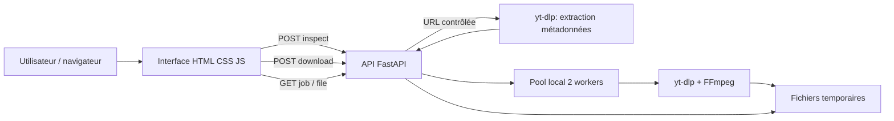

# Architecture technique — VYRA V2

> Document de reprise : décrit l'implémentation **réellement présente dans le dépôt** au 21 novembre 2026. Les pistes futures sont signalées comme telles.

## 1. Principes

VYRA est un **monolithe web auto-hébergé**. FastAPI sert à la fois les fichiers statiques du navigateur et l'API de traitement. `yt-dlp` analyse et récupère les médias depuis des URL de plateformes prises en charge ; FFmpeg effectue les fusion/transcodages requis. Une file locale exécute les tâches dans un pool de deux threads.



L'interface peut fonctionner en démo autonome, **sans requête de téléchargement**, via `DEMO_INTERFACE.html`.

## 2. Flux utilisateur et invariants

1. **Choix du réseau :** `app/static/app.js` applique le thème sélectionné ou déduit depuis le lien. Cette étape est purement ergonomique.
2. **Analyse :** `POST /api/inspect` revalide le lien HTTPS et sa plateforme, contrôle le débit de requêtes puis appelle `metadata_from_url` dans un thread.
3. **Mise en mémoire :** la réponse contient un `inspection_id` aléatoire, réutilisable au maximum 10 minutes après la création, avec les hauteurs extraites.
4. **Demande de fichier :** `POST /api/download` exige l'identifiant d'inspection et une paire `format` + `quality` compatible avec l'analyse. Une tâche entre dans le pool de téléchargement.
5. **Suivi :** le navigateur interroge régulièrement `GET /api/jobs/{id}` jusqu'à `ready` ou `error`.
6. **Récupération :** `GET /api/jobs/{id}/file` renvoie un `FileResponse` en pièce jointe. Le fichier est conservé temporairement.

Le **thème** demandé dans le navigateur ne donne aucune autorisation supplémentaire : le serveur contrôle indépendamment l'hôte, le chemin et le format. Les « résolutions » sont les hauteurs rapportées par l'extracteur ; cela ne garantit pas que tous les flux pourront être téléchargés/assemblés.

## 3. Contrats API

### `GET /api/health`

```json
{"ok":true,"engine":true,"ffmpeg":true}
```

`engine` indique que l'import Python de yt-dlp est possible ; `ffmpeg` signale que le binaire est accessible. Aucun test réseau externe n'est effectué.

### `POST /api/inspect`

```json
{"url":"https://www.instagram.com/reel/EXEMPLE/"}
```

Réponse typique **illustrative** :

```json
{
  "inspection_id":"identifiant_aleatoire_32_caracteres",
  "platform":"Instagram",
  "title":"Exemple de titre",
  "creator":"Auteur",
  "duration":85,
  "thumbnail":"https://exemple.invalid/miniature.jpg",
  "heights":[1080,720,360],
  "id":"id_extracteur"
}
```

L'exemple n'est pas le résultat d'un téléchargement réel et ne prouve pas la disponibilité d'un format. Selon le contenu, `thumbnail`, `duration` et `heights` peuvent être absents, vides ou partiels.

### `POST /api/download`

```json
{"inspection_id":"identifiant_obtenu_lors_de_l_analyse","format":"mp4","quality":"720"}
```

Pour le MP4, `quality` vaut `best` ou une hauteur détectée (par ex. `720`), **sans `p`**. Pour le MP3, utiliser `{"format":"mp3","quality":"audio"}`. Réponse HTTP `202` :

```json
{"job_id":"identifiant_de_la_tache","status":"queued"}
```

### `GET /api/jobs/{job_id}`

États actuels : `queued`, `downloading`, `converting`, `ready`, `error`. Renvoie `progress` (0–100), `message`, `error`, `filename`, et `download_url` si le fichier est prêt. Les pourcentages sont **approximatifs**, pas une durée prédite.

### `GET /api/jobs/{job_id}/file`

Renvoie une pièce jointe avec `Content-Disposition: attachment` et type `video/mp4` ou `audio/mpeg`. Ne répond que si le job est `ready` et le fichier toujours disponible.

### Erreurs notables

- `422` : URL, domaine, chemin, qualité ou média non supportés ; erreur d'extraction résumée.
- `429` : limitation de demandes par client ou saturation du nombre de tâches actives.
- `410` : identifiant d'inspection absent/expiré.
- `404` : tâche ou fichier introuvable/expiré.

L'API masque volontairement certaines erreurs internes de yt-dlp ; les logs techniques centralisés sont un travail futur.

## 4. Configuration effective

| Paramètre | Valeur par défaut | Usage |
|---|---:|---|
| `VYRA_STORAGE_DIR` | `/tmp/vyra-media` | Dossier temporaire de sortie ; chaque tâche possède un sous-dossier UUID |
| `VYRA_MAX_DURATION_SECONDS` | `7200` | Durée maximale acceptée à l'inspection (2 h) |
| `VYRA_MAX_FILE_BYTES` | `524288000` | Taille limite de fichier (500 Mio) |
| `INSPECT_TTL` | 600 s | Durée en mémoire de l'inspection (constante Python) |
| `FILE_TTL` | 2 700 s | Expiration des tâches terminées (constante Python) |
| `MAX_PENDING` | 6 | Nombre maximal de tâches actives (constante Python) |
| `executor.max_workers` | 2 | Traitements simultanés (pool local Python) |

Les limitations HTTP sont définies dans `throttle()` : **12 inspections et 5 téléchargements par minute et par IP client**. Ces compteurs sont locaux au processus, non distribués. La purge est déclenchée par `prune()` lors de requêtes API : il n'y a **pas de service périodique de nettoyage**.

## 5. Sécurité, frontières et risques

- Liste blanche d'hôtes YouTube, Instagram, TikTok et Snapchat ; URL HTTPS, absence de credentials ou port explicite, et parcours limité selon la plateforme.
- Aucun cookie de session utilisateur ni mécanisme d'authentification à des comptes tiers.
- Les extracteurs peuvent effectuer des requêtes secondaires ou suivre des redirections : **la seule vérification de l'URL d'entrée ne prouve pas l'absence de SSRF**. Bloquer les réseaux privés/locales au niveau egress et contrôler les redirections avant publication.
- Stockage dans un répertoire temporaire avec nom de dossier UUID ; le nom de téléchargement affiché est assaini pour écarter les séparateurs et caractères de contrôle.
- Pas d'isolation forte entre utilisateurs, ni autorisation d'accès par `job_id`. Ne pas considérer l'UUID comme un véritable mécanisme de contrôle d'accès.
- Pas de limite consolidée de consommation CPU/stockage ni de budget par utilisateur ; le plafond final en octets n'empêche pas toute consommation transitoire pendant le transcodage.
- Une seule instance Uvicorn (`--workers 1`) est requise avec les dictionnaires en mémoire actuels.
- Lien public = pas nécessairement contenu librement téléchargeable ; obtenir les droits et respecter les conditions d'accès.

## 6. Déploiement et dette technique

**Actuellement :** Compose construit un conteneur Node.js avec Python venv, FFmpeg, sources `app/`, utilisateur non-root et écoute `0.0.0.0:8080`. Le port est publié pour usage local ; sur une machine accessible, réduire l'exposition réseau.

**Avant exposition publique :** authentification, quotas, anti-abus, contrôles egress/SSRF robustes, isolation des workers, file de tâches persistante, backend d'état partagé, stockage avec TTL/purge programmée, supervision, logs structurés, reverse proxy HTTPS, et revue juridique. Ces mesures **ne sont pas intégrées** à V2.

## 7. Dépendances entre composants

| Composant | Dépend de | Test / modification impactée |
|---|---|---|
| `app/main.py` | FastAPI, yt-dlp, FFmpeg, système de fichiers | `tests/test_app.py`, contrat API, limites d'infrastructure |
| `app/static/app.js` | DOM de `index.html`, API FastAPI | Recette thèmes + lien + formats + erreurs |
| `app/static/styles.css` | Attribut `data-theme`, classes HTML | Captures ordinateur/mobile, accessibilité |
| `DEMO_INTERFACE.html` | Code embarqué de démonstration, aucun backend | Validation visuelle séparée ; ne pas confondre avec l'application réelle |
| `Dockerfile` et `compose.yaml` | Docker, Python, Node.js, FFmpeg | Build conteneur, santé, droits du volume temporaire |
| `tests/test_app.py` | FakeYoutubeDL, TestClient | Non-régression serveur **sans appels externes** |
